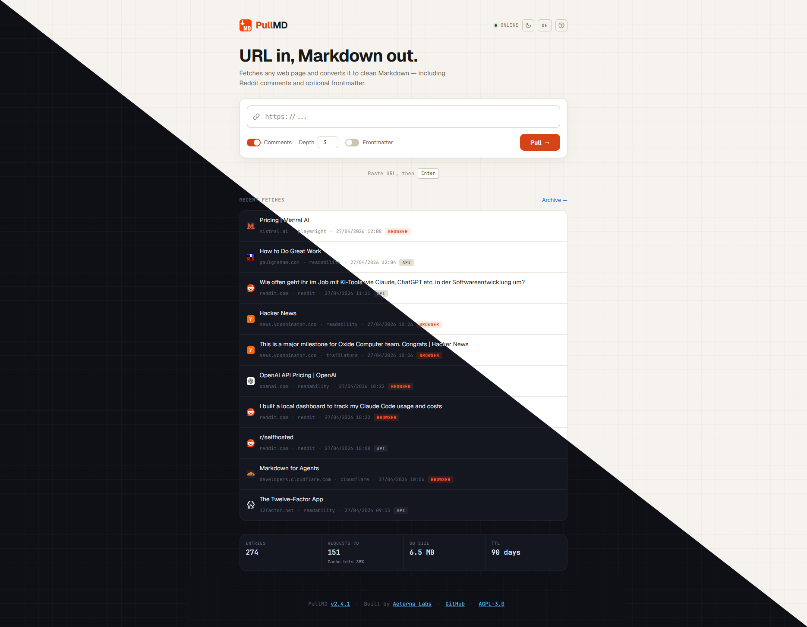

# PullMD

[](https://aeternalabshq.github.io/pullmd/)
[](https://github.com/AeternaLabsHQ/pullmd/releases)
[](https://hub.docker.com/r/aeternalabshq/pullmd)
[](https://github.com/AeternaLabsHQ/pullmd/actions/workflows/docker.yml)
[](https://github.com/AeternaLabsHQ/pullmd/blob/main/LICENSE)
[](https://aeternalabshq.github.io/pullmd/agents/mcp-server)

**Anything in, clean Markdown out.** Self-hosted conversion of web pages,
documents, images, audio and YouTube videos into token-lean Markdown, for
you and for your AI agents.

**Documentation: [aeternalabshq.github.io/pullmd](https://aeternalabshq.github.io/pullmd/)**, with installation,
configuration, guides, the API reference and the changelog.

<p align="center">
  
</p>

[Quick start](#quick-start) ·
[Use with AI agents](#use-with-ai-agents) ·
[Docs](https://aeternalabshq.github.io/pullmd/) ·
[API reference](https://aeternalabshq.github.io/pullmd/reference/api) ·
[Configuration](https://aeternalabshq.github.io/pullmd/reference/configuration) ·
[Changelog](https://aeternalabshq.github.io/pullmd/changelog)

---

## Why PullMD

Agents are bad at reading the web. Raw HTML burns context on navigation,
cookie banners and scripts, and built-in fetch tools often stumble on
JavaScript-heavy pages, PDFs and comment threads. PullMD sits in between:
one URL or file in, clean Markdown out, with source and metadata in YAML
frontmatter instead of the body.

```bash
curl "https://pullmd.example.com/api?url=https://example.com/article"
```

What that saves, measured on three public pages (tokens counted with the
`cl100k_base` tokenizer, 2026-10-16):

| Page | Plain `curl` | PullMD | PullMD with `?query=` |
| --- | ---: | ---: | ---: |
| Encyclopedia article (long-form) | 99,458 | 12,549 | 662 |
| Developer documentation page | 48,611 | 6,591 | 454 |
| Reddit thread with comments, using Reddit API credentials | blocked (bot check), no thread content | 6,381 | 644 |

The `curl` column is what a naive fetch tool hands an agent. The last
column is [query-scoped extraction](https://aeternalabshq.github.io/pullmd/guides/query-scoped-extraction): only the
sections relevant to a question.

## Highlights

**Reads almost anything**

- **Web pages** through a fallback chain: Cloudflare's native Markdown, then Readability + Trafilatura (best result wins), then headless Chromium for JavaScript-heavy sites
- **Reddit and Hacker News** threads with their comment trees (depth and count configurable; Reddit needs [API credentials](#reddit-access))
- **Documents**: PDF, Word, PowerPoint, Excel, EPUB, by URL or upload, plus an optional OCR tier for table-grade PDFs
- **YouTube** title, description and transcript with clickable timecodes, no API key needed
- **Images and audio** via any OpenAI-compatible or local model (captions, transcripts)

**Built for agents**

- **MCP server** for Claude Code and other MCP clients, with OAuth 2.1 for claude.ai and Claude Desktop
- **Query-scoped extraction**: `?query=` returns only the sections relevant to a question, typically 70-95% fewer tokens on long pages
- **Lean output**: clean body, metadata in frontmatter, unpadded tables, configurable field allowlist
- **Live share links**: `/s/:id` re-fetches when the cached copy is older than an hour and serves the last good snapshot if the source dies

**Comfortable to self-host**

- One `docker compose up`, zero config, multi-arch images (amd64/arm64) on Docker Hub and GHCR
- Every sidecar is optional, and PullMD degrades gracefully without it
- Auth modes from open homelab to multi-user, SSRF protection, rate limits, a health endpoint for Uptime Kuma
- Per-site extraction recipes as declarative JSON

**Four ways in:** PWA · REST API · MCP server · Claude Code skill

---

## Quick start

```bash
mkdir pullmd && cd pullmd
curl -O https://raw.githubusercontent.com/AeternaLabsHQ/pullmd/main/docker-compose.yml
docker compose up -d
# -> http://localhost:3000
```

No `.env` needed: every variable has a default. Add a `.env` next to the
compose file to override anything. This starts PullMD and its three optional
sidecars (Trafilatura, Playwright, MarkItDown); the Playwright sidecar alone
adds about 3.7 GB of browser binaries. Images are on Docker Hub and on GHCR
(`ghcr.io/aeternalabshq/pullmd`, `-trafilatura`, `-playwright`, `-markitdown`).

More in the docs:

- [Installation](https://aeternalabshq.github.io/pullmd/self-hosting/installation): compose files, running without a sidecar, running without Docker
- [Reverse proxy](https://aeternalabshq.github.io/pullmd/self-hosting/reverse-proxy): Traefik, nginx, Caddy, `PULLMD_TRUST_PROXY`
- [Configuration](https://aeternalabshq.github.io/pullmd/reference/configuration): every environment variable
- [Authentication](https://aeternalabshq.github.io/pullmd/self-hosting/authentication): single-admin, multi-user, API keys, OAuth
- [Upgrading](https://aeternalabshq.github.io/pullmd/self-hosting/upgrading) and [`MIGRATION.md`](./MIGRATION.md)

## Use with AI agents

Once your instance runs, `/help` on it shows every install path with your URL
filled in. Replace `${PULLMD_URL}` below with your instance's address.

**MCP server** (Claude Code, Cursor, other MCP clients; tools `read_url`, `get_share`, `list_recent`):

```bash
claude mcp add --transport http pullmd ${PULLMD_URL}/mcp
```

**Claude Code skill:**

```bash
curl -O ${PULLMD_URL}/pullmd.zip
mkdir -p ~/.claude/skills && unzip pullmd.zip -d ~/.claude/skills/
```

**Any chat agent:** paste the prompt from `/help` or from the docs.

Details: [MCP server](https://aeternalabshq.github.io/pullmd/agents/mcp-server) ·
[claude.ai and Claude Desktop (OAuth)](https://aeternalabshq.github.io/pullmd/agents/claude-ai-connector) ·
[Claude Code skill](https://aeternalabshq.github.io/pullmd/agents/claude-code-skill) ·
[Prompt for any agent](https://aeternalabshq.github.io/pullmd/agents/prompt) ·
[MCP tools reference](https://aeternalabshq.github.io/pullmd/reference/mcp-tools)

## Reddit access

PullMD reads Reddit through Reddit's Data API, using `REDDIT_CLIENT_ID` and `REDDIT_CLIENT_SECRET` from an existing app. Without them Reddit blocks the requests and `/api` answers `502`.

Reddit stopped accepting new requests for API access on 2026-10-31. It says it will start removing access for apps and users that have not registered on 2027-01-12, and close public access for all remaining apps in March 2027 ([announcement](https://www.reddit.com/r/redditdev/comments/1wubcvf/)). PullMD's Reddit support ends with that access. PullMD has no login or session cookie option, and none is planned.

More: [Reddit and Hacker News guide](https://aeternalabshq.github.io/pullmd/guides/reddit-and-hacker-news).

## Documentation

| Topic | Page |
| --- | --- |
| How the extraction pipeline works | [How it works](https://aeternalabshq.github.io/pullmd/how-it-works) |
| REST endpoints and parameters | [API reference](https://aeternalabshq.github.io/pullmd/reference/api) ([OpenAPI spec](https://aeternalabshq.github.io/pullmd/openapi.yaml)) |
| Output, frontmatter, `X-Source` and status codes | [Output format](https://aeternalabshq.github.io/pullmd/reference/output-format) |
| PDF, Office, e-mail and other documents | [Documents](https://aeternalabshq.github.io/pullmd/guides/documents) |
| Images and audio | [Images and audio](https://aeternalabshq.github.io/pullmd/guides/images-and-audio) |
| YouTube | [YouTube](https://aeternalabshq.github.io/pullmd/guides/youtube) |
| Answer only what you asked (`?query=`) | [Query-scoped extraction](https://aeternalabshq.github.io/pullmd/guides/query-scoped-extraction) |
| Share links and the cache | [Share links](https://aeternalabshq.github.io/pullmd/guides/share-links) |
| Per-site extraction rules | [Site recipes](https://aeternalabshq.github.io/pullmd/guides/site-recipes) and [`SITE-RECIPES.md`](./SITE-RECIPES.md) |
| SSRF protection | [SSRF protection](https://aeternalabshq.github.io/pullmd/self-hosting/ssrf-protection) and [`SECURITY.md`](./SECURITY.md) |
| Health checks and stats | [Monitoring](https://aeternalabshq.github.io/pullmd/self-hosting/monitoring) |
| Something doesn't work | [Troubleshooting](https://aeternalabshq.github.io/pullmd/troubleshooting) |

AI tools can read the whole site as [`llms.txt`](https://aeternalabshq.github.io/pullmd/llms.txt). The docs live
in [`website/`](./website); pages are Markdown, and pull requests are welcome.

---

## Architecture

- `server.js` - Express app factory (`createApp`) with dependency injection for tests. Exposes `/api` and `/api/stream` (SSE).
- `lib/reddit.js` - Reddit URL normalization, redirect resolution, post + comment extraction.
- `lib/web.js` - Orchestrator: Cloudflare-Markdown short-circuit, then static Readability + Trafilatura with `pickBest`, then optional Playwright re-render + re-extract on body-soup / low-quality output.
- `lib/render-decision.js` - Predicate that decides when to fall back to Playwright (readability-fellback + thin, body-soup signature, or quality < 0.5; plus `force` / `skip` overrides).
- `lib/playwright-client.js` - HTTP client for the Playwright sidecar with `AbortSignal` propagation for SSE-disconnect cancellation.
- `lib/scoring.js` - Quality scoring used to pick between extractors and as a render-trigger heuristic.
- `lib/cache.js` - SQLite cache (`better-sqlite3`) with configurable retention (default 90 days) and 32-hex (128-bit) share ids.
- `lib/mcp.js` - Stateless MCP server registering the three tools.
- `lib/distrib.js` - Public-URL substitution in `/help` and `/pullmd.zip`.
- `trafilatura-sidecar/` - Python sidecar (FastAPI) wrapping Trafilatura.
- `playwright-sidecar/` - Python sidecar (FastAPI + Playwright + Chromium) for JS-rendered pages.
- `markitdown-sidecar/` - Python sidecar (FastAPI) wrapping MarkItDown for document conversion (PDF, Office, EPUB, …) plus the keyless `/youtube` transcript endpoint.
- `lib/markitdown-client.js` - HTTP client for the markitdown sidecar (documents + YouTube).
- `lib/youtube.js` - YouTube URL detection and normalization.
- `lib/llm/` - provider resolver + adapters for image captioning (vision), audio transcription (STT), and PDF OCR against OpenAI-compatible endpoints.
- `lib/frontmatter.js` - YAML frontmatter builder with the `PULLMD_FRONTMATTER_FIELDS` allowlist.
- `lib/coverage-guard.js` - detects extractions that kept only a sliver of the page and recovers the container holding the body.
- `lib/article-series.js` - detects pages that split one piece of writing across several `<article>` blocks by the same author and joins them.
- `lib/query-extract.js` - Opt-in query-scoped extraction (`?query=`): BM25 over heading-based sections of the converted markdown, returning only the relevant sections/blocks. Composes `lib/markdown-sections.js` (block/section parser) and `lib/bm25.js` (tokenizer + scorer).
- `public/` - PWA frontend (vanilla JS, dark/paper themes, service worker, EventSource client for `/api/stream`).
- `skill/pullmd/` - Claude Code skill source (templated with `__PULLMD_URL__`).

---

## License

[GNU AGPL v3](LICENSE) - Copyright © 2026 Aeterna Labs.

PullMD is free software: you can redistribute it and modify it under the
terms of the GNU Affero General Public License as published by the Free
Software Foundation, version 3 or later. If you run a modified version
as a network service, you must make your modifications available to its
users.
